# SVI config on Multilayer switches
## Objective: to configure SVIs on Multilayer switch such that VLAN traffic can be reached

**Network toplogy; trunk, switchports and vlans already preconfigured to be same as ROAS_config lab**

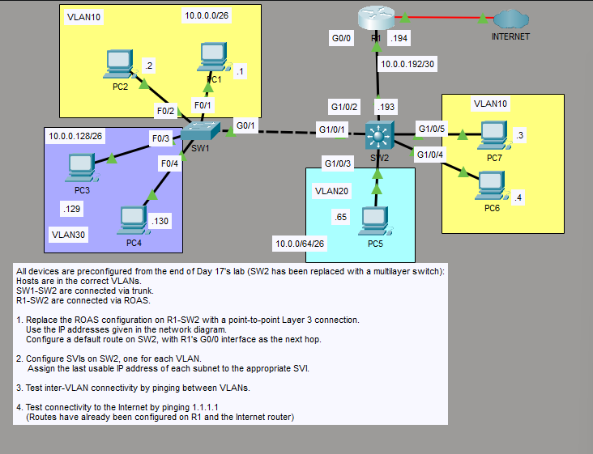


1. *to replace the ROAS config on R1 and assign point to point ip address to g0/0*

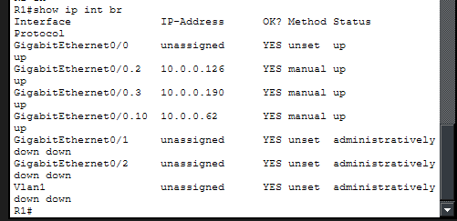

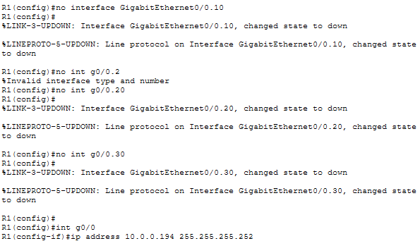


2. *Converting SW2 into multilayer switch and g1/0/2 into L3 port*

```
SW2(config)# ip routing
SW2(config)# int g1/0/2
SW2(config-if)# no switchport
```

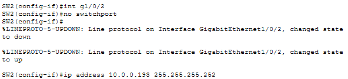


3. *Also creating a default route for the nonspecific addresses*

```
SW2(config)# ip route 0.0.0.0 0.0.0.0 10.0.0.194
```

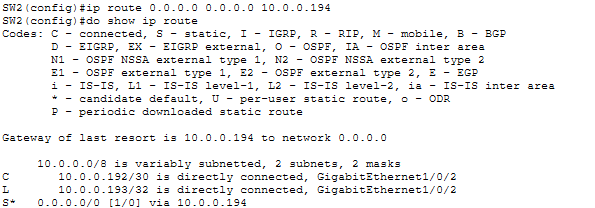


4. *Checking VLAN status on SW2 then creating SVIs that are assigned with last usable ip address of each vlan*

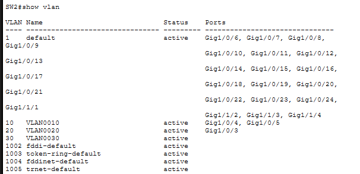

```
SW2(config)# int vlan10
SW2(config-if)# ip address 10.0.0.62 255.255.255.192
SW2(config)# int vlan20
SW2(config-if)# ip address 10.0.0.126 255.255.255.192
SW2(config)# int vlan30
SW2(config-if)# ip address 10.0.0.190 255.255.255.192
```

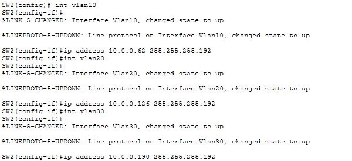


5. *SW2 routing table*

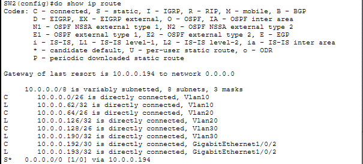


6. *testing connectivity between inter-vlan host machines*

## VLAN30 - VLAN10
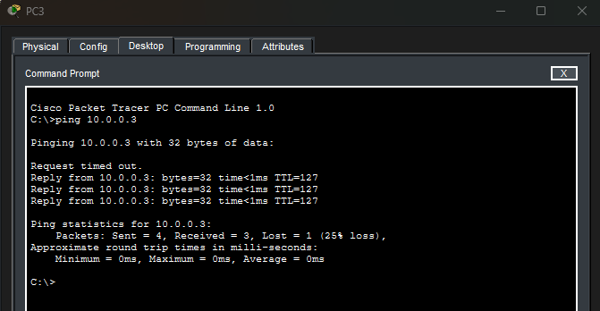

## VLAN20 - VLAN30
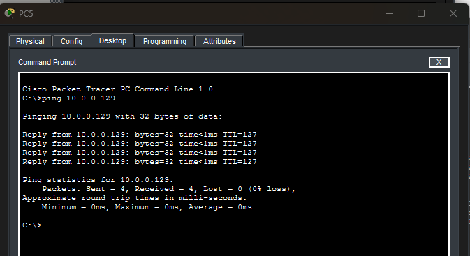

## to "internet" (default route)
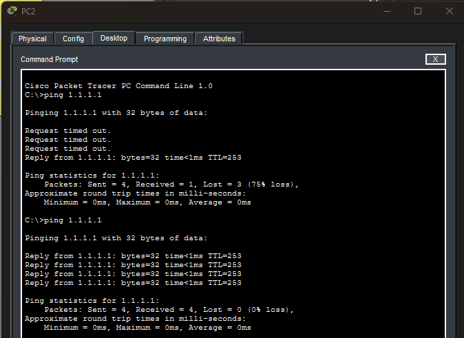


*successful pings to all destinations*

