# DTP/VTP config on switches
## Objective: to configure understand how VTP and DTP function on switches for scalable configuration

**Network toplogy including objectives listed**

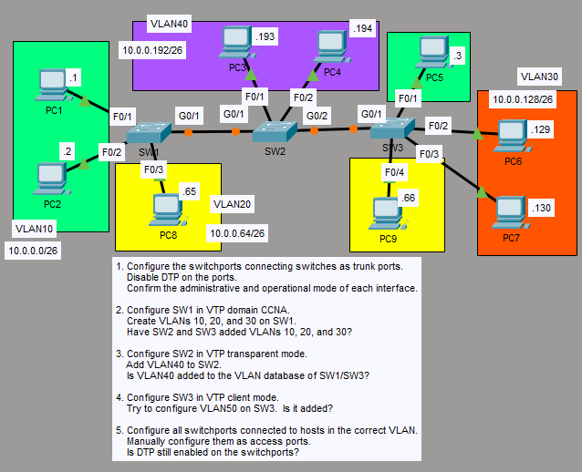


1. *to configure the switchports connecting switches as trunkports while disabling dtp with nonegotiate for best practice*

```
SW1(config)# int g0/1
SW1(config-if)# switchport mode trunk
SW1(config-if)# swtichport nonegotiate
```

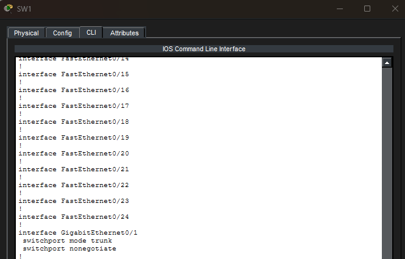

## Now similarly, for SW2 and SW3

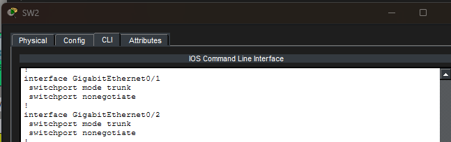

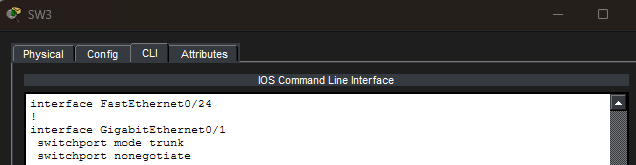

## Confirming operational mode of SW1

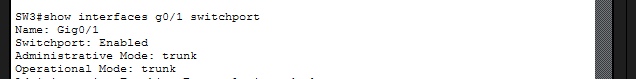


2. *Configure SW1 in VTP domain CCNA, creating VLANs 10-30*

```
SW1(config)# vtp domain CCNA
SW1(config)# vlan10
SW1(config)# vlan20
SW1(config)# vlan30
SW1(config)# show vtp status
SW1(config)# show vlan
```

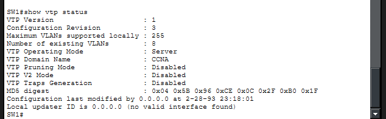

## VLANs on SW1


3. *Checking SW2 output while also configuring SW2 in transparent mode and adding VLAN40*

```
SW2(config)# vtp domain CCNA
SW2(config)# vtp mode transparent
```

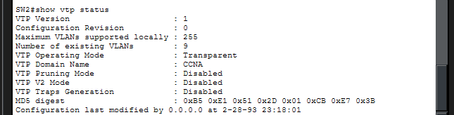

## VLANs on SW2

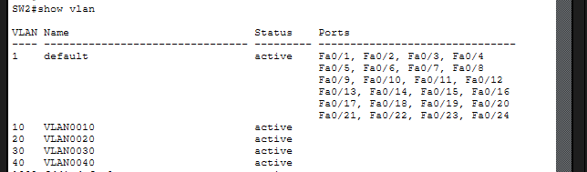

*Configure SW2 is in transparent mode, so adding VLANs does not affect SW1 in server mode*


4. *Configuring SW3 in client mode and adding checking output*

```
SW2(config)# vtp domain CCNA
SW2(config)# vtp mode client
```

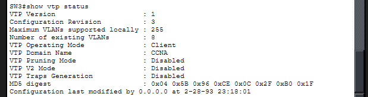

## VLANs on SW3

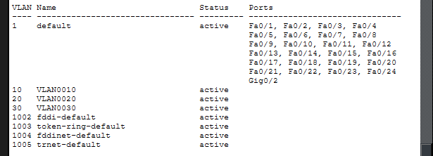

##Trying to add VLAN 50


*Adding VLAN numbers aren't allowed in client mode*


6. *converting all host connected ports to static access ports*

```
SW1(config)# int range f0/1-2
SW1(config-if-range)# switchport mode access
SW1(config-if-range)# switchport nonegotiate
```

*example output on SW1's f0/1 interface after doing this on all other switches*

```
SW1# show interfaces f0/1 switchport
```

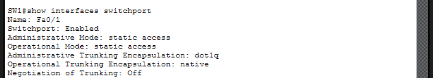


*negotiation of trunking: off*

```
SW1# show vtp
```

## SW1

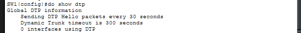

## SW2

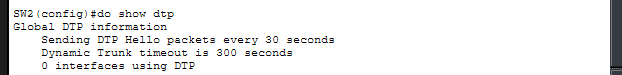

## SW3

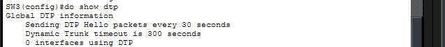


*confirming that changing to static switchport disables trunking and by extension DTP on those ports*

