# Static route config basics
## Objective to configure all devices and to set up static routes between different subnets.

**details in screenshot**

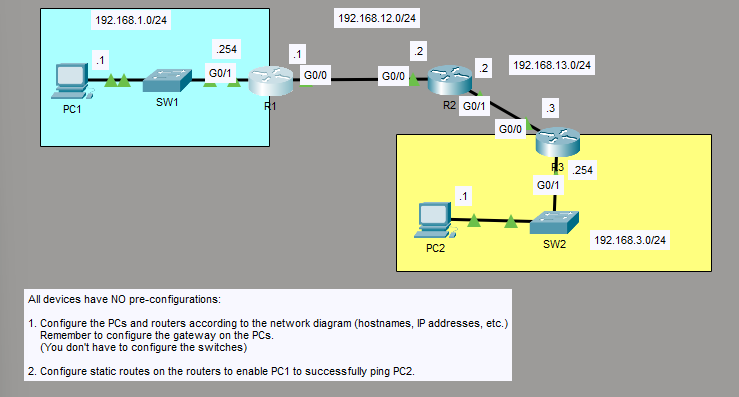

1. **Set PC1 and PC2 default gateways to be R1 int g0/1 and R3 int g0/1**

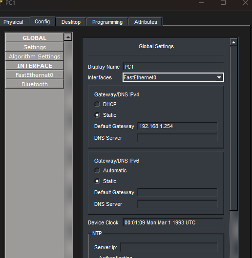

*PC1 default gateway = 192.168.1.254*

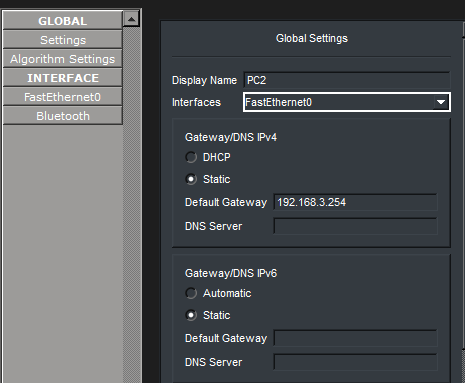

*PC2 default gateway = 192.168.3.254*


2. **Set PC1 and PC2 ip address to be the assigned address on diagram**

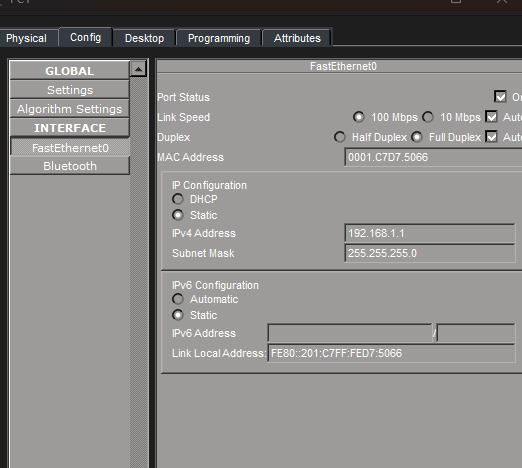

*PC1 = 192.168.1.1*

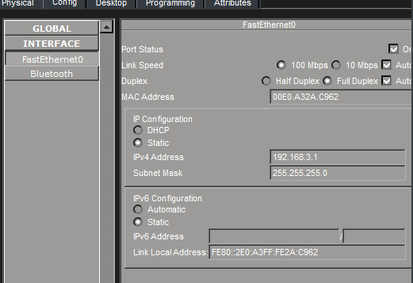

*PC1 = 192.168.3.1*


3. **configure R1 interfaces**

```
R1> en
R1# conf t
R1(config)# hostname R1
R1(config)# int g0/1
R1(config-if)# ip address 192.168.1.254 255.255.255.0
R1(config-if)# no shutdown
R1(config-if)# description [to R2]

R1(config-if)#int g0/0
R1(config-if)# ip address 192.168.12.1 255.255.255.0
R1(config-if)# no shutdown
R1(config-if)# description [to SW1]
```
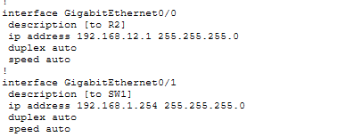


4. **configure static route from R1 to 192.168.3.0/24**

```
R1(config)# ip route 192.168.3.0 255.255.255.0 192.168.12.2
R1(config)# ip route 0.0.0.0 0.0.0.0 192.168.12.2
```
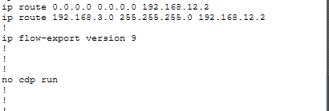


5. **configure R3 interfaces**

```
R3> en
R3# conf t
R3(config)# hostname R3
R3(config)# int g0/1
R3(config-if)# ip address 192.168.3.254 255.255.255.0
R3(config-if)# no shutdown
R3(config-if)# description [to SW2]

R3(config-if)# int g0/0
R3(config-if)# ip address 192.168.13.3 255.255.255.0
R3(config-if)# no shutdown
R3(config-if)# description [to R2]
```
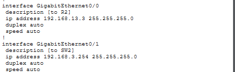


6. **configure static route from R3 to 192.168.1.0/24**

```
R3(config)# ip route 192.168.1.0 255.255.255.0 192.168.13.2
R3(config)# ip route 0.0.0.0 0.0.0.0 192.168.13.2
```
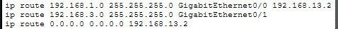


7. **configure R2 interfaces**

```
R2> en
R2# conf t
R2(config)# hostname R2
R2(config)# int g0/0
R2(config-if)# ip address 192.168.12.2 255.255.255.0
R2(config-if)# no shutdown
R2(config-if)# description [to R1]

R2(config-if)# int g0/1
R2(config-if)# ip address 192.168.13.2 255.255.255.0
R2(config-if)# no shutdown
R2(config-if)# description [to R2]
```
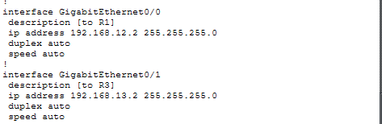


8. **configure static route from R2 to both 192.168.1.0/24 and 192.168.3.0/24**

```
R2(config)# ip route 192.168.1.0 255.255.255.0 g0/0 192.168.12.1
R2(config)# ip route 192.168.3.0 255.255.255.0 g0/1 192.168.13.3
```
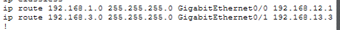


9. **Resulting ping from PC1 to PC2 checking if the static routes work**

```
ping 192.168.3.1
```
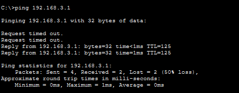


10. **Resulting ping from PC2 back to PC1 to check vice versa**

```
ping 192.168.1.1
```
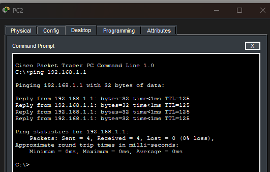


*Both sides can ping each other*
