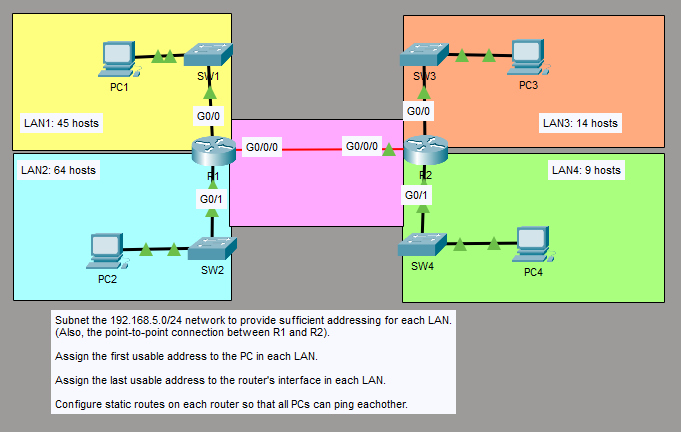
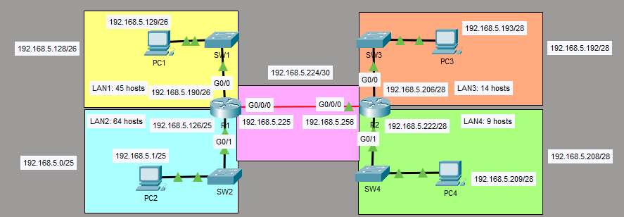
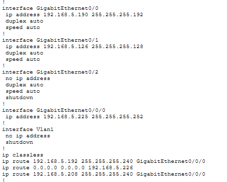
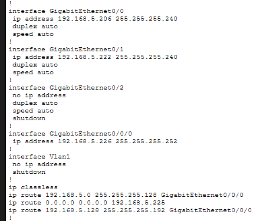
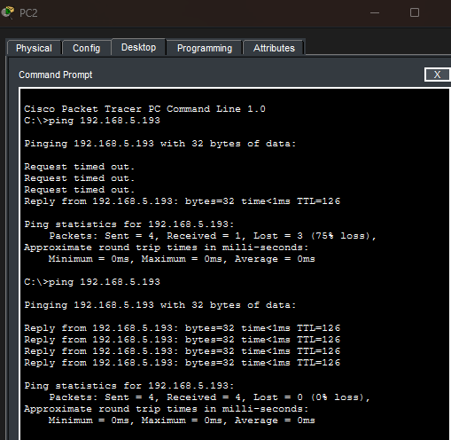
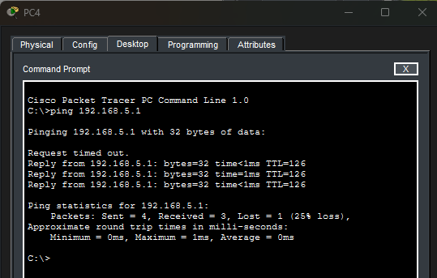

# Static route config basics
## Objective to assign subnets according to host requirements and configure static routes

**details in screenshot**

1. **given ipv4 address 192.168.5.0/24 to be divided into 4 subnets**

*64 (/26) only allows for 64-2 host units, which means /25 is needed = 1000 0000 (128 host units)
As a result each LAN will have following network addr
LAN 2: 192.168.5.0/25
LAN 1: 192.168.5.128/26
LAN 3: 192.168.5.192/28
LAN 4: 192.168.5.208/28
point to point: 192.168.5.224/30*

2. **config on R1 will be as follows for assigned ip addresses**

*static routes to both vlan 3 and 4 are added*

3. **config on R2 will be as follows for assigned ip addresses**

*static routes to both vlan 1 and 2 are added*

4. *Resulting ping from PC2 to PC3 checking if the static routes work**

5. *Resulting ping from PC4 to PC2 checking if the static routes work**

*Both sides can ping each other*
